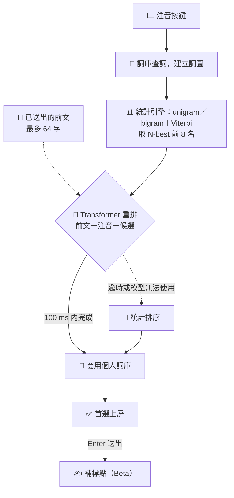
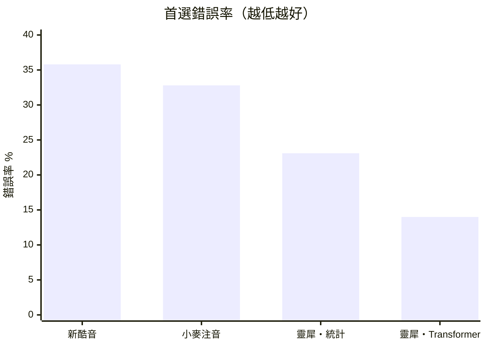

<p align="center">
  
</p>

<h1 align="center">靈犀注音 0C</h1>

<p align="center">
  <b>免選字，把話打完。</b><br>
  在你的電腦上用 Transformer 看前文選字的注音輸入法，支援 Linux、macOS 與 Windows。
</p>

<p align="center">
  <a href="https://github.com/0c-biggo/0c-ime/releases/latest"></a>
  <a href="https://github.com/0c-biggo/0c-ime/actions/workflows/checks.yml"></a>
  <a href="legal/README.md"></a>
  
  
</p>

<p align="center">
  <a href="https://0c.biggo.com">官網</a> ·
  <a href="https://0c.biggo.com/download/">下載</a> ·
  <a href="https://0c.biggo.com/technology/">選字技術</a> ·
  <a href="docs/README.md">使用者文件</a> ·
  <a href="https://0c.biggo.com/guide/basics/">操作指南</a> ·
  <a href="https://0c.biggo.com/docs/cli/">CLI 文件</a> ·
  <a href="https://0c.biggo.com/help/">支援</a> ·
  <a href="https://0c.biggo.com/privacy/">隱私</a> ·
  <a href="https://github.com/0c-biggo/0c-ime/issues">回報問題</a>
</p>

<p align="center">
  
</p>

> **English** — 0C (靈犀注音) is a Zhuyin (Bopomofo) input method for Traditional Chinese. An on-device Transformer language model reads what you have just written and picks the right homophones, so you can type a whole sentence without stopping to choose characters. It runs entirely on your computer, and ships shells for Fcitx5, IBus, macOS InputMethodKit and Windows TSF.

> **日本語（プレビュー）** — 0C は繁体字中国語の注音入力のほか、日本語のかな漢字変換を開発中です。ローマ字・かな入力、文節変換、学習、予測、記号・顔文字に対応するコアと、Windows の単一 Mixed プロファイルを用意しています。変換品質の数字はまだ小さな種子辞書の実測値で、Mozc などと比較できる段階ではありません。日本語の既定モデルセット（extra reranker＋public 句読点）は HF revision を固定済みですが、まだ推論には接続しておらず、Windows の Phase 2 VM 検証は NOT RUN です。詳しくは[日文輸入（預覽）](#-日文輸入預覽)。

## ✨ 特色

- 🧠 **Transformer 選字**：自行訓練的語言模型參考整段前文與注音判斷同音字，大多數時候不必停下來挑字。
- ⇥ **Tab 補全**：有把握才提示後續字詞，按 Tab 接受；補全只來自詞庫與個人片語，不生成新內容。
- 🔒 **全在本機**：選字、補標點與個人學習都在你的電腦上以 CPU 執行，不連網、不上傳打字內容。
- 📚 **我的詞彙**：人名、術語、英文指令加進來就排在前面，也看得到靈犀學到了什麼。
- 🔤 **中英混打、自動加空格、模糊音、Emoji 與顏文字**：可選擇在中文字和英文字母相連處自動補半形空格（「用Python寫」送出「用 Python 寫」）；ㄗ／ㄓ、ㄘ／ㄔ、ㄙ／ㄕ、ㄣ／ㄥ 近音放在後面備選；按 = 開 Emoji 選單。
- 🀄 **單一 Mixed profile**：Windows 只有一個「Mixed」輸入法，注音、日文羅馬字與英文在同一個組字區直接輸入，不必切換語言。主要語言只是排序偏好。逐片段候選跟著游標，長詞詞庫 match 是一項候選。詳見 [輸入與候選](docs/typing.md)。
- 🔁 **輸出簡體字、自訂選字鍵**：看繁體打字、送出時才轉簡體，可從輸入法選單一鍵切換；選字鍵可用 1–0 或 asdfghjkl;。
- ✍️ **送出時補標點**（Beta）：Enter 送出時在漢字之間補上 ，。？！、；，不改動你打的字。產品使用原生 ONNX 補標點；模型不可用時才保留原文。
- 🛟 **自動退回**：模型無法啟動或回應太慢時改用統計引擎排序，打字不會卡住。

<p align="center">
  
</p>

## 🎯 免選字是怎麼做到的

傳統注音輸入法靠詞庫與詞頻挑字，只看得到相鄰的一兩個詞。靈犀注音在統計引擎之上多了一層 Transformer 重排：



1. **列出可能的句子** 📖：依注音在詞庫找出所有可能的字詞，以 unigram／bigram 統計語言模型與 Viterbi 在詞圖上搜尋最可能的組合，打字時即時更新。
2. **Transformer 重排** 🧠：讀入剛送出、游標仍緊接其後的前文（最多 64 字）、目前的注音與每個候選，替前 8 名重新評分。attention 能同時參考整段前文，不只看緊鄰的詞。
3. **本機學習** 👤：你選過、改過的字詞記在本機個人詞庫，下次同樣的情況優先出現。
4. **有把握才補全** ⇥：後續字詞的信心夠高時才顯示 Tab 建議。

## 🀄 單一 Mixed profile 與混合輸入

Windows 只有一個「Mixed」輸入法，注音、日文羅馬字與英文在同一個組字區直接輸入：

- **不用切換語言**：合法注音留在中文；有載入日文資料時，合法羅馬字轉日文；英文詞、網址、數字與識別字照原文。
- **主要語言只是偏好**：`zh`／`ja` 影響先驗、切換成本與模型常駐順序，不阻擋其他語言。
- **逐片段候選**：候選範圍跟著游標所在片段。Windows 在候選窗沒開時用 Home／End／←／→ 換片段，會自動為新片段重開候選。
- **長詞是一項候選**：詞庫長詞跨過多個輸入片段時合併成一個片段，候選只出現一次。
- **目前限制**：日文模型包（extra reranker + public 標點）已 pin HF revision，但日文轉換尚未接上 shipped 資料包；Windows Phase 2 VM 驗收是 **NOT RUN**。

操作、按鍵與未接上的日文設定見 [輸入與候選](docs/typing.md)；日文模型包見 [模型與模型包](docs/model-sets.md)。

## 🇯🇵 日文輸入（預覽）

日文輸入還在整合階段，不是正式支援的功能。目前 repo 內有這些部分：

- 核心支援かな與羅馬字組字、文節轉換、候選、預測、カタカナ／半角カナ、変換／無変換鍵；記号與顔文字載入器在 `core/ja/rewrite`。
- 日文個人學習與ライブ変換的程式在 `core/ja/personal`、`core/ja/live`；設定程式有對應選項，但正式引擎路徑尚未全部接上。
- Windows TSF 只有一個 Mixed profile。注音、日文羅馬字與英文在同一個組字區，不再有 ja-JP「靈犀日本語」profile；舊版留下的 ja-JP 會在升級時清掉。
- `0c-compile -lang ja -public` 編譯的日文資料包，隨附 `data/ja/NOTICE.txt` 的逐來源授權。

目前 repo 的日文資料包是 137 詞條的種子包，不是 Mozc 全量詞典；`make assets LANG=ja` 會編譯這份資料。Windows 套件可選擇內附 `data/ja/`：

```sh
make assets LANG=zh                 # 注音字典與模型
make assets LANG=ja                 # 日文資料包，輸出 build/ja
make assets LANG=all                # 注音與日文一起準備
make assets MODELS_ONLY=1           # 只換注音模型，需已有 assets/data
python3 scripts/package_windows.py --data assets/data --ja-data build/ja ...
```

系統需求與注音相同：Windows 10 1803 以上 x64 或 Windows 11 x64。安裝後直接從中文（台灣）的鍵盤清單選「Mixed」，不需要另裝 ja-JP 語言。沒有日文資料包時，注音、英文與更新流程照常，日文功能不載入詞典，不影響注音。

**目前限制**：Windows 套件放入的是編譯後的 `data/ja/`，但引擎的日文載入路徑目前讀 `lexicon/words.tsv` 與 `connection.tsv`；在整合接上編譯包之前，不能假設 shipped package 的日文轉換已完成。日文模型包由 Hugging Face 提供已 pin 的 reranker（CC BY-SA 4.0）與 punctuation（MIT）；產品只有這一個模型包，沒有其他選擇。尚未接入推論。Phase 2 的 Windows VM 驗收是 **NOT RUN**，見 [VM 執行紀錄](platforms/windows/test/vm/LIVE-RUN.md)。正式產品不 import 或啟動 llama.cpp、GGUF、zenz。

### 量測

T33 在凍結的題庫上量測目前的統計轉換。分數低是因為 137 詞條種子包覆蓋不足，不代表轉換器上限，也不能拿來和注音的 86.0% 或 Mozc 比較。

| 題庫 | n | 首選 top-1 | 前 5 名 top-5 | 文節邊界 exact | 邊界 F1 |
|---|---:|---:|---:|---:|---:|
| `modern-500` | 500 | 23.2% | 23.2% | 14.4% | 0.445 |
| `hard-cases` | 35 | 14.3% | 14.3% | 14.3% | 0.238 |
| `anthy-corpus1` | 200 | 2.5% | 2.5% | 1.5% | 0.253 |
| `ajimee-200` | 200 | 1.5% | 1.5% | 不計 | 不計 |

規則、題庫雜湊與 CI 門檻見 [testdata/ja/README.md](testdata/ja/README.md)。延遲只在同一台機器比較，不進 CI 門檻。

## 📈 評測：首選錯誤少約六成

在事前凍結、模型沒看過的台灣新聞測試（2026-09-24〜26，共 6,000 例，一半是困難的同音短詞）上：

| 方法 | 首選正確率 | 首選錯誤率 |
|---|---:|---:|
| 新酷音 0.11.0 | 64.2% | 35.8% |
| 小麥注音 | 67.2% | 32.8% |
| 靈犀注音（只用統計引擎） | 76.9% | 23.1% |
| **靈犀注音（Transformer 重排）** | **86.0%／86.1%** | **14.0%** |



測試規格、成功標準與評分程式都在讀取資料前凍結，只評一次；讀音由字典合成、答案取原文，不是真人打字紀錄。外部輸入法採對它們最有利的輸入方式、無個人詞庫。靈犀注音的兩個數字來自兩個不同的訓練種子；「只用統計引擎」也是模型無法啟動時的表現。免選字是目標而非保證：罕見人名與詞庫外的詞仍可能要手動選。

### 🧩 模型

| | 選字（`models/select/`） | 補標點（`models/punct/`） |
|---|---|---|
| 架構 | 因果 Transformer decoder：8 層、寬度 512、8 個 attention head，約 3,261 萬參數 | 雙向 Transformer encoder |
| 輸入 | 前文（最多 64 字）＋注音＋候選 | 送出的文字，不看前文 |
| 權重 | [Funmula/0c-sequence-d512](https://huggingface.co/Funmula/0c-sequence-d512) | [Funmula/0c-punct-d512](https://huggingface.co/Funmula/0c-punct-d512) |

模型從零開始訓練，不使用通用大型語言模型的權重，採用 RoPE、GeGLU 等現代化元件。一般桌機 CPU 上選字的 P95 延遲約 7 ms（短片段）至 16 ms（長片段）；兩個模型合計約 250 MB。密碼欄位、暫停學習及英數模式下不送任何文字給模型。更多數字與方法見 [選字技術](https://0c.biggo.com/technology/)。

## 📥 安裝

Windows、macOS、Linux 安裝包請到官網下載：👉 [0c.biggo.com/download](https://0c.biggo.com/download/)

逐步的安裝、升級、回復與移除，以及資料保留位置，見 [安裝、升級、回復與移除](docs/install.md)。

發行版打包請用 [Releases](https://github.com/0c-biggo/0c-ime/releases/latest) 的 `0c-ime-<版本>.tar.xz`：內附現成字典，符合 DFSG，解壓即可建置；已配對的神經模型在另附的 `0c-ime-models-<版本>.tar.xz`。見 [打包與發佈](PACKAGING.md)。

Windows 解除安裝不會刪個人詞庫；`install.ps1 -Rollback` 或 `0c-update rollback` 回到上一版，`0c-update rollback -restore-user` 一併還原升級前的詞庫。內附的日文資料在該版本的 `data/ja/`，回復時跟著切換版本，注音字典與 `%LOCALAPPDATA%\Zuin\user.json` 不受影響。完整步驟見 [安裝、升級、回復與移除](docs/install.md) 與 [打包與發佈](PACKAGING.md#windows-安裝移除與回復)。

## 🛠️ 從原始碼建置

需要 Go 1.26 以上；測試與發佈工具使用 Python 3.11 以上。以下指令在 repo 根目錄執行，不會安裝或重啟桌面輸入法：

```sh
git clone https://github.com/0c-biggo/0c-ime.git
cd 0c-ime
make assets          # 下載與這份原始碼相符的字典與模型
go test ./...
go run ./cmd/0c-cli -data assets/data
```

`make assets` 從同版本的 [Release](https://github.com/0c-biggo/0c-ime/releases) 取得原始碼與模型 tarball（合計約 275 MB），驗證後把現成字典放到 `assets/data/`、已配對模型放到 `models/select/` 與 `models/punct/`，和出貨內容相同；0.2.2 起 Release 附的 Source code 壓縮檔也適用。要指定版本用 `make assets RELEASE=v0.2.2`，只取字典用 `make assets MODELS=0`（約 36 MB，以統計選字運作），只換模型用 `make assets MODELS_ONLY=1`（需已有字典）。日文資料包用 `make assets LANG=ja` 從 `data/ja` 編譯到 `build/ja`，`make assets LANG=all` 會同時處理注音與日文。

`cmd/` 下工具的旗標、輸入輸出與範例見官網 [CLI 文件](https://0c.biggo.com/docs/cli/)，例如 [0c-cli](https://0c.biggo.com/docs/cli/0c-cli/)、[0c-update](https://0c.biggo.com/docs/cli/0c-update/)、[0c-mcp](https://0c.biggo.com/docs/cli/0c-mcp/)。

日文相關命令：

```sh
go run ./cmd/0c-compile -lang ja -public -out build/ja   # 編譯公開日文資料包
go run ./cmd/0c-eval-ja                                  # 跑 T33 題庫並印摘要
go run ./cmd/0c-eval-ja -gate                            # 與 baseline 比較，退步時非零結束
go run ./cmd/0c-eval-ja -write-baseline testdata/ja/baseline.json   # 刻意更新 baseline
```

`0c-eval-ja` 的 `-data`、`-rules`、`-baseline`、`-out`、`-determinism` 旗標與題庫重建方式見 [testdata/ja/README.md](testdata/ja/README.md)。

發行版維護者以 `make install PREFIX=/usr` 做系統安裝、由套件管理員更新，見 [Linux 系統安裝](platforms/linux-system/README.md)。

各平台外殼另需各自的工具鏈與系統函式庫：

| 平台 | 外殼 | 建置說明 |
|---|---|---|
| 🐧 Linux | Fcitx5（C++） | [platforms/linux-fcitx5](platforms/linux-fcitx5/README.md) |
| 🐧 Linux | IBus（Go） | [platforms/linux-ibus](platforms/linux-ibus/README.md) |
| 🍎 macOS | InputMethodKit（Swift） | [platforms/macos](platforms/macos/README.md) |
| 🪟 Windows | TSF（Rust） | [platforms/windows](platforms/windows/README.md) |
| ⚙️ 設定程式 | Tauri | [platforms/settings](platforms/settings/README.md) |
| 🧠 神經推論 | 原生 ONNX Runtime；沒有執行階段時退回統計引擎 | [platforms/neural](platforms/neural/README.md) |

## 🗂️ 專案結構

```text
core/         輸入法邏輯：注音解析、詞圖解碼、語言模型、候選重排、個人學習（不做 I/O）
bridge/       引擎與外殼之間的行程間通訊（IPC）
internal/     設定、自動更新、原生神經推論、詞庫編譯與評測等共用程式
cmd/          執行檔入口：0c-server、0c-ibus、0c-update、0c-cli、0c-compile、0c-eval…
platforms/    Linux／macOS／Windows 外殼、設定程式、神經推論
docs/         使用者文件：安裝、輸入與候選、模型包、授權
data/         詞庫來源、來源帳本與授權聲明
models/       上游模型與字典配對的固定清單
scripts/      建置、打包與回歸測試工具
testdata/     測試資料
```

詞庫格式與資料來源見 [data/README.md](data/README.md)，模型版本與配對見 [models/README.md](models/README.md)。

## 🤝 參與貢獻

歡迎回報問題與送 PR！請先看 [參與開發](CONTRIBUTING.md)：回報時附上版本、平台與逐鍵重現步驟；改程式前後跑一次檢查：

```sh
python3 scripts/check_public_tree.py
go test ./...
go vet ./...
make -C platforms/linux-fcitx5 test
make test-upgrade
make test-release
```

版本變更見 [CHANGELOG](CHANGELOG.md)。

## 📄 授權

自有程式採 AGPL-3.0-only，另可洽談商業授權；自有圖示與圖片採 CC BY-SA 4.0。公開核心資料用 CC BY 4.0、公共領域或 permissive notice-only，模型用 MIT；CC BY-SA 資料與模型是另一個 experimental set；UniDic BSD 與 IPADic 的聲明義務、Windows 的 ONNX Runtime／MSVC runtime 邊界見 [授權頁](docs/licensing.md)。逐來源與逐檔說明見 [授權說明](legal/README.md)。
